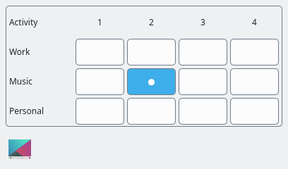

# 2D Activity Pager

A Plasma panel button that opens a popup grid for switching to an exact activity
and virtual desktop pair. Activities are rows; desktops are columns. The current
position is marked with a filled cell and dot, while a pending destination shows
an ellipsis.
An opaque theme-colored background and outer border frame the entire grid.



The expanded grid and panel button, rendered with example activities. Appearance
follows your KDE theme.

The initial target is **Plasma 6.6.6 on Wayland**. Plasma 6.6's activities library
no longer exposes stopped activities or start/stop operations; the widget follows
its available activities model. See KDE's
[6.6 changelog](https://kde.org/announcements/changelogs/plasma/6/6.5.5-6.6.0/)
and the [design ADR](docs/adr/0001-two-dimensional-activity-desktop-pager.md).

## Build

On Ubuntu/Kubuntu 26.04:

```sh
sudo apt install build-essential cmake ninja-build extra-cmake-modules \
  qt6-base-dev qt6-declarative-dev libplasma-dev \
  libplasmaactivities-dev plasma-sdk

cmake -S . -B build -G Ninja \
  -DCMAKE_BUILD_TYPE=Release -DCMAKE_INSTALL_PREFIX=/usr
cmake --build build
ctest --test-dir build --output-on-failure
cmake --build build --target all_qmllint
```

Tests cover switching races, superseded requests, failures, timeouts, keyboard and
mouse navigation, dynamic grid updates, and the desktop D-Bus protocol. The D-Bus
integration test uses a private bus and a mock KWin service, so it does not switch
your actual workspace. Tests require permission to create a local Unix socket.

## Preview without installing

Run from the repository root in your KDE session:

```sh
QT_PLUGIN_PATH="$PWD/build/bin${QT_PLUGIN_PATH:+:$QT_PLUGIN_PATH}" \
  plasmoidviewer -a local.twodpager -f horizontal -l bottomedge -s 480x240
```

The preview uses your real activities and desktops. Open the grid with its panel
button. Clicking a cell switches
your workspace just like the installed widget.

## Install in the panel

```sh
sudo cmake --install build
```

Open the panel's **Add Widgets** picker and search for **2D Activity Pager**. Drag
it onto your panel. If it is not listed after installation, log out and back in,
then reopen the picker. When updating an already loaded version, log out and back
in to load the rebuilt native plugin.

The panel contains a compact grid-icon button; its tooltip shows the current
activity and desktop. Click it to open the popup, which sizes itself to the grid.
Long activity names are elided; hover to see their full names. Hover a desktop
column number or destination cell to see its full desktop name.

Opening the popup focuses the current cell. Arrow keys move through the grid;
Space or Enter activates the focused destination. The latest selection wins while
a switch is pending. The popup closes on success and stays open on failure for
retrying. Errors appear briefly in a passive message; the actual current cell
remains highlighted. Escape, clicking outside, or clicking the panel button again
closes the popup. Closing it leaves an in-progress switch running.

This is a compiled Plasma 6.6 applet with embedded QML. Installing it with
`kpackagetool6` alone is insufficient. CMake installs the native plugin into Qt's
Plasma applet plugin directory; the exact installed path is recorded in
`build/install_manifest.txt`.

## Implementation

- `applet/qml/`: Plasma entry point and grid presentation.
- `src/kdeworkspace.*`: native activities model/controller and asynchronous KWin
  D-Bus desktop integration, including service restart recovery.
- `src/switchcontroller.*`: serialized switching with latest-selection replacement,
  observed-position verification, a 300 ms settling period, and a 5-second timeout.
- `tests/`: switching tests, QML interaction tests, and isolated D-Bus integration.

Activity changes and desktop changes cross process boundaries and are not atomic.
The controller observes the selected activity before requesting its desktop and
rechecks the resulting pair while KWin restores remembered state. The settling
period is a practical allowance, not an atomic transaction guarantee. A timeout or
rejected request reports an error without issuing a rollback.

## Remove

Remove the widget from the panel, then run:

```sh
sudo cmake --build build --target uninstall
```

Keep the build directory and installation manifest until removal. Rebuild the
plugin after incompatible Qt or Plasma upgrades.
